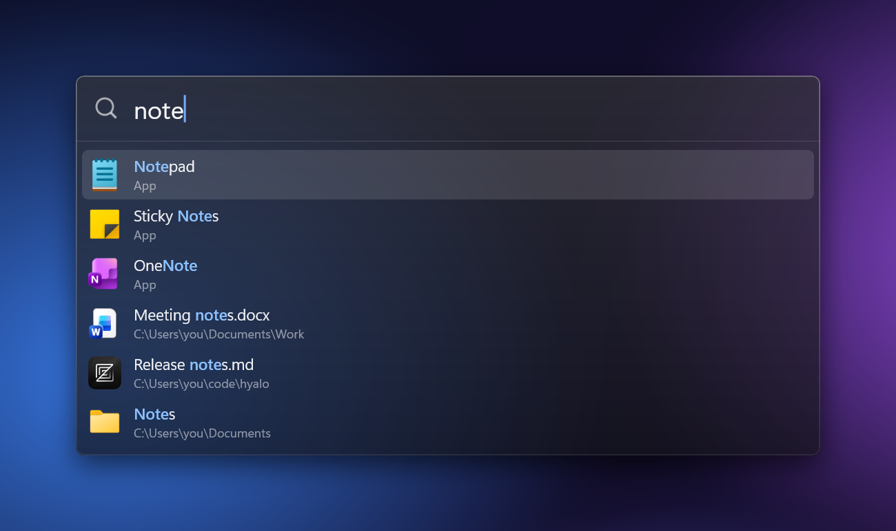
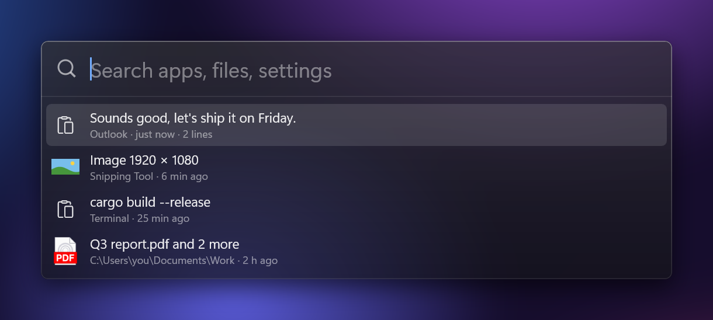
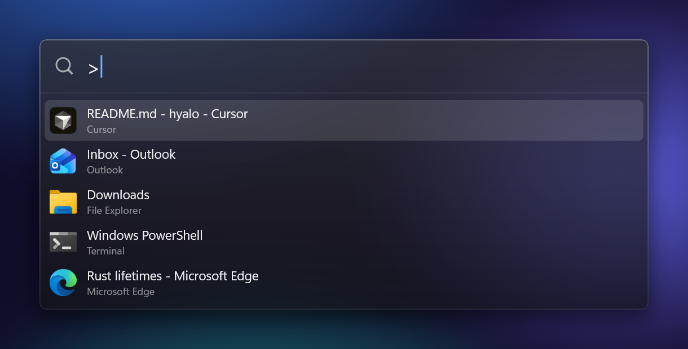
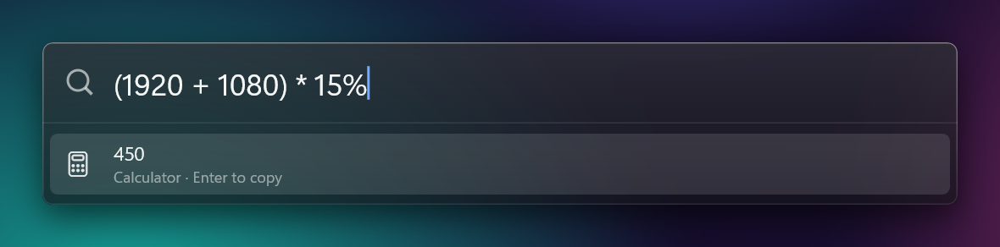
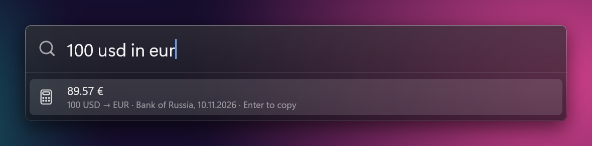
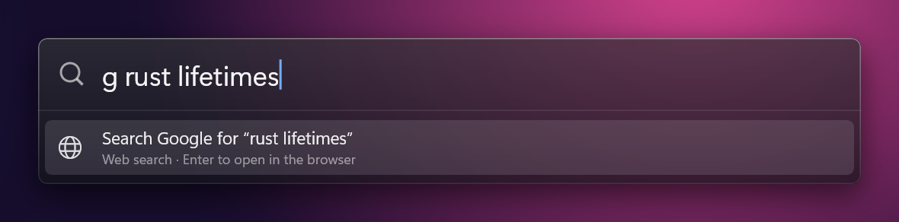
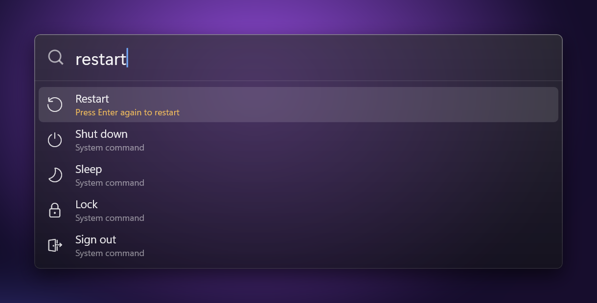
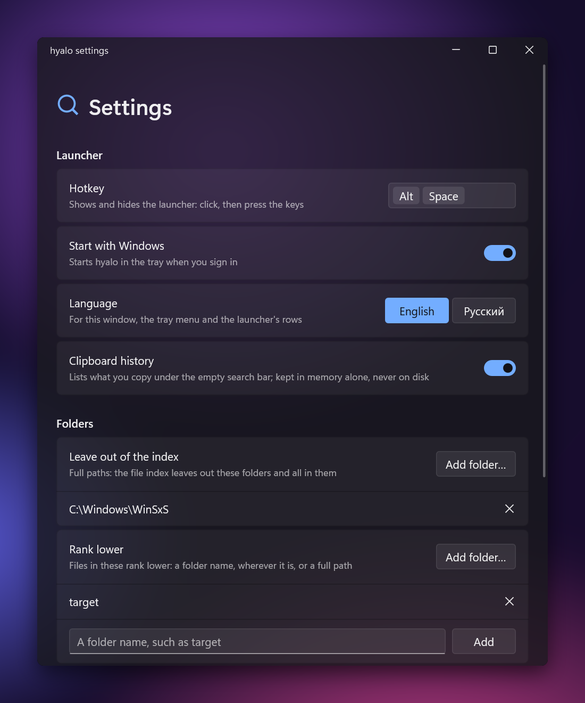

<p align="center">
  
</p>

<h1 align="center">hyalo</h1>

<p align="center">
  <b>A fast, native launcher for Windows, drawn in frosted glass.</b><br>
  Press a hotkey, type a few letters, press Enter.
</p>

<p align="center">
  <a href="https://github.com/IlyaShorin/hyalo/releases/latest"></a>
  <a href="https://github.com/IlyaShorin/hyalo/releases"></a>
  
  
  <a href="LICENSE"></a>
</p>

<p align="center">
  
</p>

hyalo finds your apps, files, folders and Windows settings as you type. It also does arithmetic, converts currencies, searches the web, switches windows and remembers what you copied. It is a single 1.5 MB exe with nothing to install beside it. It draws its own glass with Direct2D and DWM, so there is no Electron, no .NET and no runtime. It never needs administrator rights and sends no telemetry.

## Features

- **One box for everything.** Start menu and Store apps, every file and folder on your fixed drives (kept current as they change), 88 Windows Settings pages and Control Panel items, and system commands such as Lock and Restart.
- **Ranking that learns.** Apps come before files, your folders before caches, and what you pick rises the next time. Word starts and acronyms match (`vsc` finds Visual Studio Code), and so does a query typed in the wrong keyboard layout (`мысщву` finds `vscode`).
- **Filters** narrow files by extension, folder, size and date: `report ext:pdf in:Downloads mod:7d`.
- **Instant answers.** Arithmetic, currency conversion at the day's official rates, and web search prefixes of your own (`g`, `gh`, `yt`, `w`, …).
- **Window switcher.** Type `>` to list your open windows and jump to one.
- **Clipboard history.** The empty search bar lists what you copied: text, pictures and files. Enter puts an entry back. It is kept in memory only, and anything a password manager marks private is skipped.
- **Native and light.** Written in Rust on Win32, Direct2D and DirectComposition. hyalo searches more than two million names in a few milliseconds and [keeps pace with Everything](#speed).
- **Takes care of itself.** It installs per user without admin rights, updates from GitHub Releases (each download checked against its SHA-256) and starts with Windows if you ask it to.
- **Speaks English and Russian.**

<table>
  <tr>
    <td width="50%"><br><b>Clipboard history</b> under the empty bar</td>
    <td width="50%">"><br><b>Window switcher</b>: type <code>&gt;</code></td>
  </tr>
  <tr>
    <td>
      <br>
      <br>
      <br>
      <b>Answers</b>: arithmetic, currencies, web searches
    </td>
    <td><br><b>System commands</b> that ask before they act</td>
  </tr>
</table>

## Install

1. Download `hyalo.exe` from the [latest release](https://github.com/IlyaShorin/hyalo/releases/latest).
2. Run it. It copies itself to `%LOCALAPPDATA%\Programs\hyalo` and waits in the tray. There is nothing to click through and no admin prompt.
3. Press **Alt+Space**.

From then on hyalo updates itself. A new version shows up as a quiet notice under the search bar and in the tray menu, and Install puts it in place.

The exe is not code-signed yet, so Windows SmartScreen may warn about it on first run. Choose *More info*, then *Run anyway*. Each release lists the exe's SHA-256 beside it.

**Requirements:** Windows 11 22H2 or later for the glass. Windows 10 (1709 or later) and older Windows 11 builds run it on a solid dark background. `hyalo.exe --portable` runs from where it is without installing.

## Using it

| Keys | What they do |
|---|---|
| <kbd>Alt</kbd>+<kbd>Space</kbd> | Show or hide hyalo (change it in Settings) |
| <kbd>↑</kbd> <kbd>↓</kbd>, <kbd>Enter</kbd> | Choose a row and open it, or copy an answer |
| <kbd>Ctrl</kbd>+<kbd>Enter</kbd> | Show a file or folder in Explorer |
| <kbd>Ctrl</kbd>+<kbd>Shift</kbd>+<kbd>Enter</kbd> | Run as administrator |
| <kbd>Ctrl</kbd>+<kbd>C</kbd> | Copy the selected file's path |
| <kbd>Shift</kbd>+<kbd>Delete</kbd> | Uninstall the selected app (asks first) |
| Right click, <kbd>Shift</kbd>+<kbd>F10</kbd> | Everything the row can do |
| <kbd>Esc</kbd> | Hide |

| Type | To get |
|---|---|
| `note` | Apps, settings pages, files and folders that match |
| `ext:pdf in:Downloads q3` | Files narrowed by extension and folder; also `size:>10mb`, `mod:today`, `mod:2026-11` |
| `(1920 + 1080) * 15%` | The calculator's answer |
| `100 usd in eur`, `10$ в евро` | A conversion at the Bank of Russia's daily rates |
| `g rust lifetimes` | A Google search; also `gh`, `yt`, `w` (Wikipedia), `ya`, and any you add |
| `>`, `>outlook` | Your open windows |
| *(nothing)*, `"report` | The clipboard history, or a search through it |

Drag the window by its glass to move it; a double-click on the glass puts it back in the middle. The [guide](docs/guide.md) covers every detail.

## Speed

Measured on one machine, with more than two million names on two NVMe drives, against Everything 1.4 and its service:

| | hyalo | Everything |
|---|---|---|
| A search, median | 2–6 ms | 2–11 ms |
| Loading the saved index at start | 0.36 s walked; 0.41 s from its indexer service | 0.55 s |
| Memory the index takes | 212 MB | 220 MB |
| Building the index from nothing | 2.7 s with its indexer service; 104 s walking, with your rights | 10.6 s, with admin rights |

Reading a drive's master file table needs administrator rights. hyalo's indexer service, installed once from the settings window, reads it, so hyalo itself never runs as administrator; without the service hyalo walks the folders as you, and only once. Either way it then loads its saved index and follows every change as it happens. The [full results and method](docs/benchmarks.md) are written up.

## Settings

Open **Settings** from the tray icon, or edit `%APPDATA%\hyalo\config.toml` in any editor. Changes apply the moment you save, and the file keeps your comments.

<p align="center">
  
</p>

| Setting | Default | |
|---|---|---|
| `hotkey` | `"Alt+Space"` | Shows and hides hyalo |
| `language` | Windows' own | `"en"` or `"ru"` |
| `clipboard_history` | `true` | Keep what you copy, in memory |
| `check_for_updates` | `true` | Look for a new release once a day |
| `[folders] exclude` | `['C:\Windows\WinSxS']` | Leave folders out of the index |
| `[folders] rank_lower`, `rank_higher` | `['target']`, `[]` | Push folders' files down or up |
| `[search]` | `g`, `gh`, `w`, `ya`, `yt` | Web search prefixes: `prefix = "https://…{query}"` |

## Privacy

hyalo has no accounts and sends no telemetry. It makes two small requests of its own, both with the user agent `hyalo/<version>` and nothing about you:

- `api.github.com`, at most once a day, to see whether a new release is out. Turn it off with `check_for_updates = false`.
- `cbr.ru`, about once a day, for the Bank of Russia's exchange rates.

The file index, your picks and your settings stay on your disk, in `%LOCALAPPDATA%\hyalo` and `%APPDATA%\hyalo`. The clipboard history is never written anywhere and is gone when hyalo exits.

## Uninstall

1. In the tray menu, turn off *Start with Windows*, then choose *Exit*.
2. Delete `%LOCALAPPDATA%\Programs\hyalo`.
3. To remove your settings and index too, delete `%APPDATA%\hyalo` and `%LOCALAPPDATA%\hyalo`.

## Building from source

You need the Rust MSVC toolchain and Visual Studio Build Tools with the C++ workload.

```sh
git clone https://github.com/IlyaShorin/hyalo
cd hyalo
cargo build --release -p hyalo
```

The exe lands in `target\release\hyalo.exe`. [docs/development.md](docs/development.md) covers the architecture, the tests, the quality gates and releases.

## Contributing

Issues and pull requests are welcome. Changes are made test first, with the platform glue kept thin and every decision in plain, tested Rust; [docs/development.md](docs/development.md) describes the workflow and the checks a push must pass.

## Acknowledgements

[Heimdall](https://github.com/Kryzern/Heimdall) was the inspiration. Thanks also to [Everything](https://www.voidtools.com/), [Flow Launcher](https://www.flowlauncher.com/), Raycast and macOS Spotlight for showing how it should feel.

## License

[MIT](LICENSE) © 2026 Ilya Shorin
